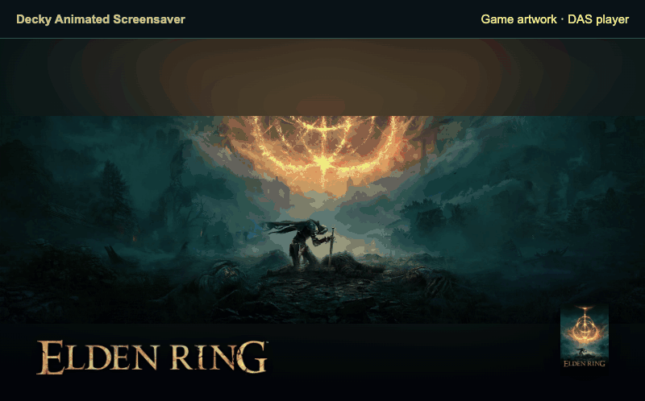

# Animated Screensaver

This project is derived from [Steam Animated Screensaver](https://github.com/Alyenax/Steam-Animated-Screensaver).

Prepare animated game artwork for Steam Deck and Steam Machine in Decky. Choose
SteamGridDB artwork, build a collection, and install it as a Steam screensaver.
TV playback works independently. The optional JSAUX Faceplate integration uses a
compatible GabeCubeAura installation to control the hardware.

Created and maintained by **Alyenax**.

If Animated Screensaver makes your Steam Deck or Steam Machine a little better,
you can support its development on Ko-fi. Thank you! ❤️

[](https://ko-fi.com/alyenax)

[Download 1.0.0](https://github.com/Alyenax/Decky-Animated-Screensaver/releases/tag/v1.0.0) ·
[User guide](docs/wiki/Home.md) · [Changelog](CHANGELOG.md)



Artwork credits: [TUFKAC, fewwan, Morente, jho and official Steam artwork](docs/wiki/media/CREDITS.md).

## Features

- Build a collection from installed games, search and public Steam discovery lists.
- Choose animated or still backgrounds, covers, logos and per-game framing.
- Reorder games and configure duration, shuffle and transitions.
- Render gentle movement from original still images, or keep them fixed.
- Preview choices, then prepare and install the collection. Prepared media can be reused offline.
- Optionally prepare separate Faceplate artwork through compatible GabeCubeAura.

## Install

Download `Decky-Animated-Screensaver-v1.0.0.zip` from the release page. In Decky
Loader, enable Developer mode if needed, then use **Developer → Install plugin
from ZIP** and select the archive. Open **Animated Screensaver** in Decky.
See [Installation](docs/wiki/Installation.md) for the complete setup.

## Setup and use

Open Animated Screensaver in Decky, configure your SteamGridDB key, and install
the media tools if needed. Add games, choose artwork and update your collection.
Video tools identifies the downloaded FFmpeg/ffprobe Linux x86_64 distribution
and shared libraries (about 64 MB), its BtbN/FFmpeg-Builds source, and the exact
installation folder reported by Decky (`cinema-tools-v1` in this plugin's
settings directory).
Native Decky controls support controller navigation. Storage, import, settings
export and local diagnostics are available in Settings.

To start, complete **Settings → Setup**, add games under **Add games**, then
choose artwork in **My collection**. Select **Prepare and install** and confirm.
After successful installation, select **decky-animated-screensaver** in
**Steam → Settings → Customization → Screensaver**. Set its inactivity delay
separately in Steam’s Power settings. Previewing does not activate the Steam
screensaver.

Faceplate controls appear when a compatible device is available. SteamOS
rendering, controller focus and physical JSAUX playback still require testing on
the target machine; desktop builds and automated tests do not establish those
results.

## Updates

The public build reads public GitHub release metadata anonymously. Stable is the
default channel; Beta can also select public beta releases. Private alpha
releases are excluded. No GitHub login, token or private-repository connection is
used. Checks use the public release repository linked above.

Automatic checking is enabled by default with a fixed **24-hour interval**, also
used for the first scheduled check after startup. You can disable it and use
**Check for updates now** without waiting for the interval when no update
operation is in progress. Checks never download or install code.
Download and installation each require a manual action. Installation verifies
the checksum and complete package manifest, requires confirmation, checks that
no game/preparation is active, restarts Decky and keeps rollback protection.

See [Update behaviour](docs/UPDATES.md).

## Diagnostics and settings backups

**Settings → Storage and assistance → Save local diagnostic** writes the full
report to `diagnostic.json` in the plugin's Decky settings directory. Its exact
path is displayed after saving; the report can also be viewed in the interface.
The file has owner-only permissions. Nothing is uploaded.

The report includes every field formerly collected for the online JSAUX report,
including player relay/debug evidence, browser evidence, USB-operation receipts,
preparation errors, discovery, artwork metadata and local delivery checks. The
complete JSAUX report is under `jsaux_delivery`; wider workflow, workspace,
installation, media tools, event and update details are also included. Credentials
and media bytes remain excluded. No reconnect, cancellation or preparation is
triggered by saving a report. Optical playback is only reported as observed when
actual evidence exists.

Advanced settings support local JSON export/import of TV, Faceplate and interface
mode/layout. Export writes a JSON file under `Documents/AnimatedScreensaver`
in your home folder and shows its exact path. Keys, games, artwork, update
preferences, calibration and interface language are excluded. Import needs
confirmation and preserves the previous configuration.
There is no GitHub settings-backup upload in this build.

## Development

Use Node.js with pnpm 9 and Python 3. Install Python Pillow for the image tests.

```sh
pnpm install --frozen-lockfile
pnpm run typecheck
pnpm run test:frontend
pnpm run test:backend
pnpm run build
pnpm run package
```

Packaging writes a versioned ZIP and `SHA256SUMS` under `out/`. Source files and
licenses accompany the compiled frontend. User settings, credentials, generated
media, optional runtime tools and development dependencies are excluded.
Packaging does not publish a release.

GPL-3.0-only; see [LICENSE](LICENSE). Game artwork and trademarks belong to their
respective rights holders. Animated Screensaver is an independent community
project, not affiliated with Valve or JSAUX.
