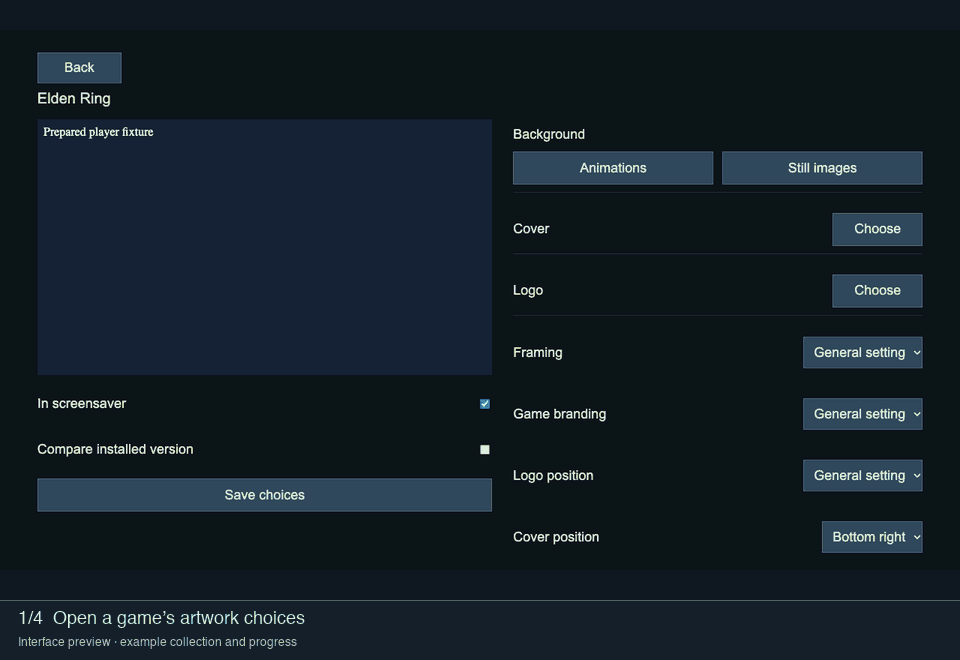

# Artwork

Open a game in **My collection**. Choose a background, cover and logo separately.

*Local interface walkthrough. Artwork selection is shown with example search results.*

## Background

Use **Animations** for animated artwork or **Still images** for a static background. If **Allow still images** is enabled, DAS can use a still image when no matching animation exists. With fallback disabled, a game without an animation is skipped rather than treated as a failed download.

For a still image, **Image movement** offers **Gentle movement** or **Still
image**. Gentle movement is rendered by the player from the original image;
it does not encode that still image into a video. **Reduced motion** disables
this movement. Smoothing applies to supported animated media during preparation.
A source preview shows the original; use the prepared or installed preview to
check the playback result.

## Cover and logo

Choose these separately from the background. Playback settings control whether they appear and where they are placed. **Game name** can show a logo, title, both, or neither. A missing optional cover or logo does not necessarily prevent a valid background from playing.

## Framing

| Setting | Result |
| --- | --- |
| Original · no crop | Keeps the complete image. Borders may remain. |
| 16:9 · TV | Crops the image to the TV format. |
| 16:10 · Steam Deck | Crops the image to the Steam Deck format. |

Use the crop controls to position the important part of an image. Check the preview after changing framing or branding.

## Save and apply

Saving records your choices. It does not start conversion or install a replacement. Return to the collection and [prepare and install](Preparation.md) when ready.

Faceplate images are chosen separately from TV backgrounds. See [GCA integration](GCA-Faceplate-Integration.md).
