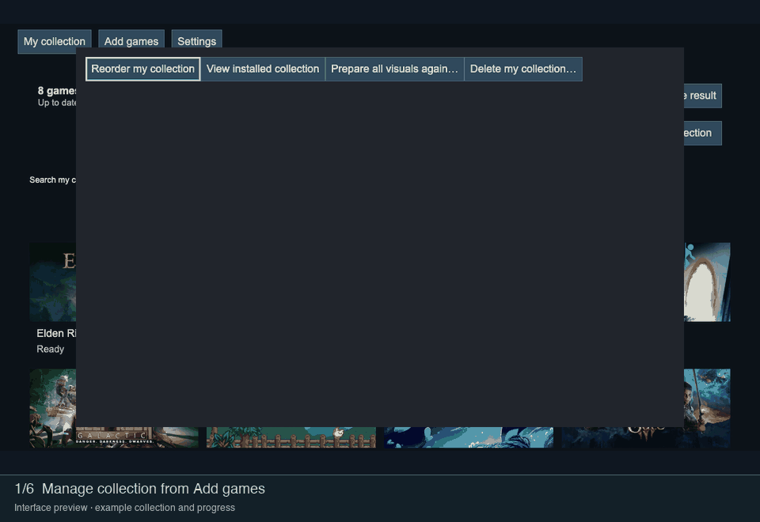

# Games and collection

## Add games

Open **Add games**. Select installed games, search for a title or use the available discovery lists. Adding a game selects it for your collection; it does not prepare or install its artwork immediately.

Use **Select all** for the current results when you want to add several titles. Review the selection in **My collection**. Steam library import is only needed to list owned games that are not installed; it is not required for search.

## Review your collection

Search and filters help find games that need attention or have changes to prepare. Choose Comfort, Compact or List to change the presentation. Open a game to choose its [artwork](Artwork.md).

**Deselect all** clears the selection and offers Undo. This is different from deleting the installed collection.

## Reorder

From **My collection** or **Add games**, open **Manage collection → Reorder my collection**. Press **X** to enter reordering, move the focused game with the arrows, then press **X** to save the order. Update the collection afterwards to apply it to the installed screensaver.

*Production interface in a local browser, with controller events simulated for the walkthrough.*

TV shuffle can override ordered playback. It is disabled while Faceplate playback is synchronised.

## Remove a collection

The collection management menu provides a separate removal action with confirmation. It clears collection membership and removes DAS’s installed collection. Prepared sources and settings can be reused later; other screensavers are not removed.

Removing a game from the working selection does not immediately replace the installed screensaver. Use [Prepare and install](Preparation.md) to apply collection changes.
