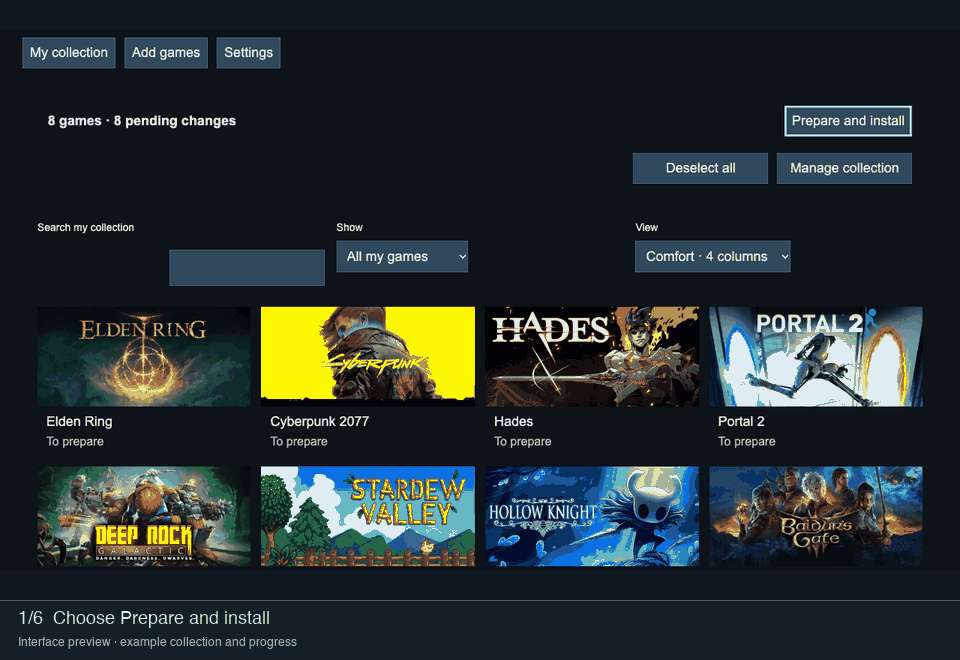

# Decky Animated Screensaver wiki

> User guide for Animated Screensaver 1.0.1.

Decky Animated Screensaver (DAS) prepares game artwork for Steam’s screensaver. Choose games and images, preview the result, then prepare and install the collection. TV and Steam Deck playback work without GabeCubeAura. Faceplate output is an optional integration.

**By Alyenax · [Support on Ko-fi](https://ko-fi.com/alyenax)**

## Start here

| Guide | What it covers |
| --- | --- |
| [Installation](Installation.md) | Requirements, installation and selecting the screensaver in Steam. |
| [Setup](Setup.md) | SteamGridDB key, video tools and optional Steam library import. |
| [Games and collection](Games-and-Collection.md) | Add games, select titles, reorder and remove a collection. |
| [Artwork](Artwork.md) | Backgrounds, still images, covers, logos and cropping. |
| [Preparation](Preparation.md) | Confirm, pause, resume, update and rebuild. |
| [Preview and Steam playback](Preview-and-Steam.md) | What previews show and how installed playback starts. |
| [Playback settings](Playback.md) | Timing, transitions, shuffle and display format. |
| [Optional Faceplate](GCA-Faceplate-Integration.md) | Separate images, coordinated or independent playback, and the GCA light bar. |
| [Settings and backups](Settings-and-Backups.md) | Advanced settings, JSON export/import and storage. |
| [Troubleshooting](Troubleshooting.md) | Missing artwork, interrupted preparation and playback problems. |
| [Privacy and credits](Privacy-and-Credits.md) | Keys, network requests, artwork ownership and licence. |
| [GIF walkthroughs](Media.md) | Player demonstration and interface walkthroughs. |

## First collection

Complete **Settings → Setup**, select games in **Add games**, then use **Prepare and install**. After completion, select **decky-animated-screensaver** in Steam’s screensaver settings. See the [preparation guide](Preparation.md) for the full sequence.

[Project README](README.md) · [Changelog](CHANGELOG.md) · [Support development](https://ko-fi.com/alyenax)
